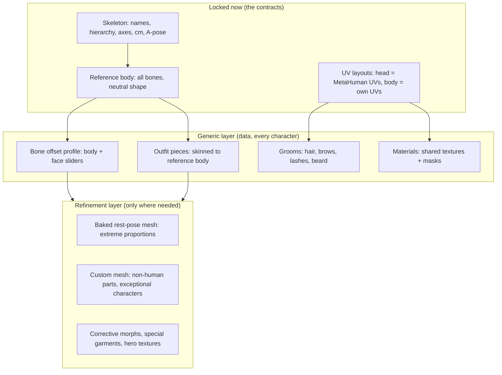
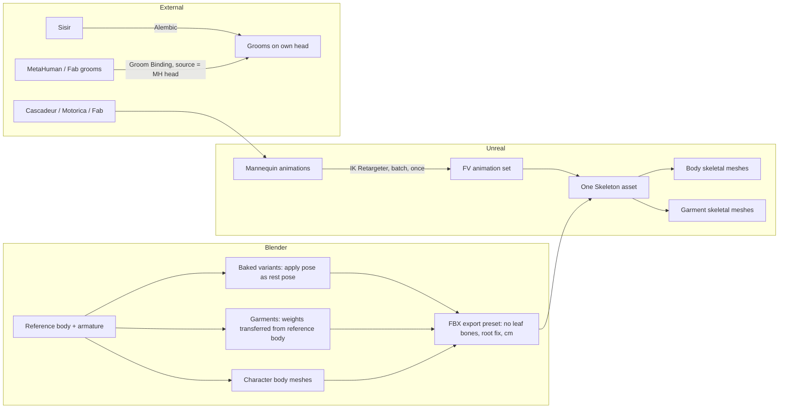
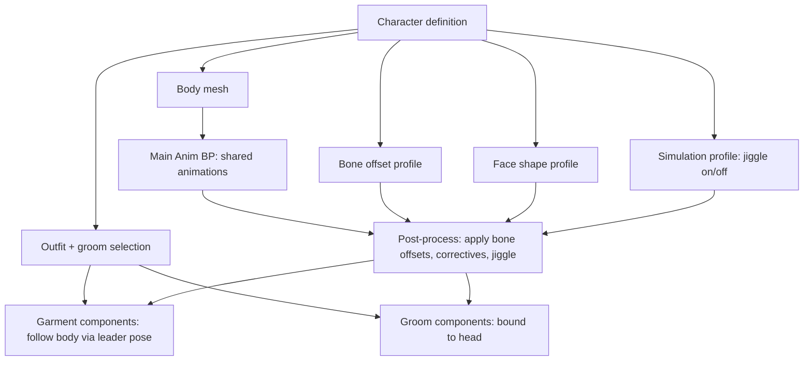
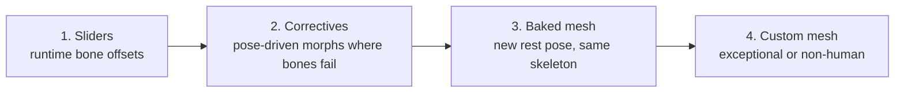
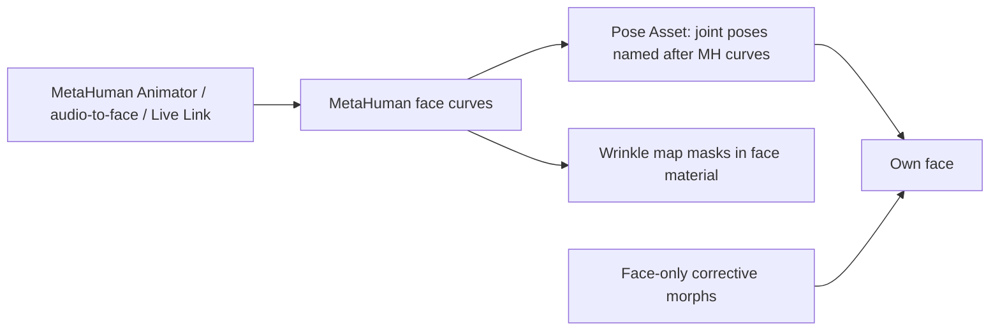
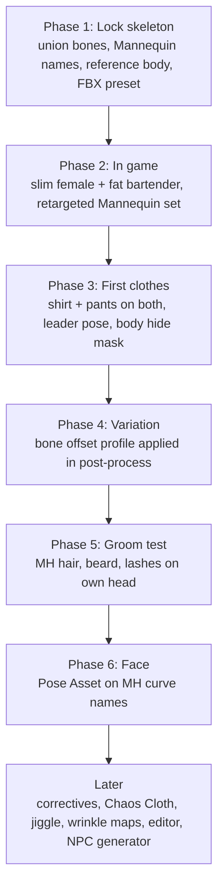

# FlickerVoid Character Model Pipeline

Concept for building characters on the owner's own base model, non-destructively: one generic system covers everyone, and any single character can be refined later without breaking the rest.

Status: concept, agreed in the "character model pipeline" thread (2026-10-17). Clothing switching and outfit data get consolidated later with the outfit/clothes thread.

## 1. Principles

- **Own model, own topology.** No MetaHuman or Daz bodies. Bodies can be non-human: severed limbs, prosthetics, extra parts.
- **Bones are the parameters.** Body and face shape come from bone offsets, not blendshapes. Clothes, grooms and face poses follow automatically because they are skinned to the same bones.
- **One skeleton, many meshes.** Every character uses the same Skeleton asset with the full bone list, at most about 250 bones.
- **Generic first, refine later.** Everyday variety is data (slider values). Exceptional characters get a refined mesh on the same skeleton, and nothing else changes.
- **Contracts are locked early.** These are bone names, hierarchy, rest orientation, units and UV layouts. Everything else (textures, correctives, grooms, jiggle) can be added later.

## 2. The skeleton contract (do this first)

| Locked | Rule |
|---|---|
| Bone names | UE5 Mannequin names for the body chain (root, pelvis, spine_01..05, neck_01/02, head, clavicle, upperarm, lowerarm, hand, fingers, twist bones, ik_ bones) |
| Extra bones | Shape, jiggle, face and non-human bones are **leaves** under main-chain bones, never inserted into the chain |
| Bone set | The **union** of everything: female breast bones and male belly bones exist on every body; each body weights only what it uses |
| Rest pose | A-pose, centimetres, fixed bone axes |
| Budget | About 200 to 250 bones; extras stripped at lower LODs for NPCs |

Changing these later breaks things: renaming, reparenting or reorienting bones. Adding new leaf bones later is fine, because Unreal merges them into the Skeleton and existing animations still play.

**Reference body.** One Blender file holds the armature and a neutral body with all bones. Every garment is weighted against it. It is the source of truth for the skeleton.

## 3. Asset pipeline (Blender to Unreal)

- Import the reference body first; it creates the Skeleton. All bodies and garments import onto it.
- Skeleton translation retargeting: **Animation Scaled** on root and pelvis, **Skeleton** on the rest, so one animation fits every body.
- One retarget of the Mannequin set serves every character.

## 4. Runtime assembly

- **Bone offsets are applied after the animation** (post-process anim blueprint or a small Control Rig), otherwise the animation overwrites them.
- **Garments** follow the body through leader pose. Rule: a garment may only use bones that every body has, which the union skeleton guarantees.
- **Hiding skin under clothes**: each garment carries a mask of the body region it covers, in body UV space; shared body UVs make one mask work for every body.
- **Jiggle** runs only where the simulation profile turns it on. Garments inherit it for free.
- **Crowds**: merge body and outfit into one mesh for background NPCs. Draw calls cost more than bones.

## 5. Variation ladder

Climb only as far as a character needs. Most NPCs stop at 1. The fat bartender may need 2 (belly lift when the leg raises). A giant or child goes to 3. Cyber or deformed characters go to 4. Every level uses the same skeleton, animations, garments and grooms.

## 6. Face

- Target the **MetaHuman face curve names**, not ARKit's 52 shapes. Epic's tools output those curves, so any MetaHuman facial animation drives the face without retargeting.
- A Pose Asset adds poses linearly; author combination poses (smile + jaw open) where they look wrong.
- Allow a small set of **face-only corrective morphs** for lip seal and cheek volume, where joints struggle.
- Wrinkle maps: textures in head UV space blended by the same curves (topic still to discuss).

## 7. Hair (grooms)

- Grooms (hair, eyebrows, eyelashes, beard) bind to the own head with **Groom Binding, source = MetaHuman head, target = own head**. Epic's docs require matching UVs only; the head UVs match.
- If face variety comes from bones on one head mesh, one binding per groom covers every face.
- MetaHuman card and mesh LODs are built on the MetaHuman head and need re-skinning; strands bind cleanly.
- Sisir for custom grooms: free beta, Windows, Alembic export, transfers across topology; no hair cards yet.
- **Decisive test:** bind one MetaHuman hair, one beard and one set of lashes to the own head, then play a facial animation.

## 8. Clothing (model side)

- Model on the reference body; transfer weights from it (Blender Data Transfer), **including shape bones**, so garments follow sliders.
- At extremes add garment **corrective shape keys** driven by the same parameter as the body, only where it visibly fails.
- Fit and length (skinny, baggy, shorts) are **different garments**, not variants. Detail is LODs. No body-build variants; a garment that cannot follow (belly overhang) gets a one-off mesh for that character.
- Chaos Cloth only for loose parts (coats, skirts). Prosthetics are garment-like pieces following the body.

## 9. Character editor and NPC generation

- **Editor**: sliders on shape bones, face presets saved as poses, groom and outfit pickers. One widget can serve both the authoring editor and the in-game character creator.
- **NPC generation**: an archetype lists slider ranges, a simulation profile, and per-slot pools of garments and grooms. The generator rolls sliders, picks one item per slot, and saves the result as a profile.

## 10. Roadmap

**Phase 2 and 3 done when** both characters run in game with the retargeted animations and wear the same shirt and pants without tearing.

## 11. Verified vs inferred

| Claim | Status |
|---|---|
| Groom Binding transfers across different topology when UVs match | Verified (Epic docs) |
| MetaHuman conform tools need MetaHuman topology; 5.7 recovers vertex IDs via UVs | Verified (Epic docs, MetaHuman 5.7 news) |
| Sisir: free beta, Windows, Alembic, cross-topology transfer, no cards | Verified (CG Channel, 80.lv) |
| Adding leaf bones keeps existing animations working | Established engine behaviour |
| Leader-pose follower bones missing from the leader freeze at ref pose | Inferred, test once on 5.8 |
| One groom binding covers bone-driven face variants | Inferred, part of the groom test |
| Garments follow baked rest-pose meshes via leader pose | Inferred, test with an extreme case |
| MetaHuman curves drive a joint Pose Asset well enough for dialogue | Inferred, part of phase 6 |

## 12. Open questions

- Are all faces human, or do some need a fully custom head rig? (Both use the same face curves.)
- Is the head vertex-identical to the MetaHuman head, or does it only share UVs?
- Still to discuss: textures and materials (reusing MetaHuman textures through the shared head UVs), wrinkle maps, the eye shader.

Sources: [Epic: Setting up bindings for grooms](https://dev.epicgames.com/documentation/en-us/unreal-engine/setting-up-bindings-for-grooms-in-unreal-engine), [MetaHuman 5.7 body conforming](https://www.metahuman.com/news/metahuman-5-7-brings-major-improvements-to-body-conforming-with-more-to-come), [Body conform controls](https://dev.epicgames.com/documentation/metahuman/body-conform-controls), [CG Channel on Sisir](https://www.cgchannel.com/2026/07/sisir-is-a-promising-new-free-standalone-hair-grooming-tool/), [80.lv on Sisir](https://80.lv/articles/sisir-new-guide-based-hair-grooming-tool)
