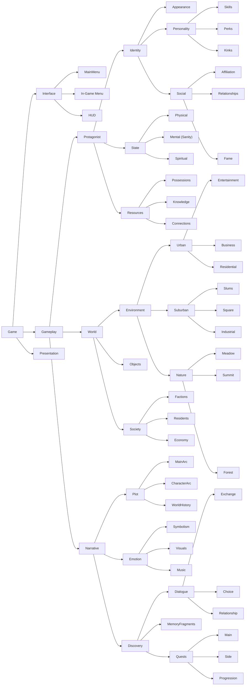

# FlickerVoid Framework Design

Status: implemented in `feature/framework-dev`, revised after the owner's answers of 2026-10-05 (recorded at the end). The architecture decisions of 2026-10-16 (layers, ontology, AngelScript and C++ boundary, module and folder structure) are in Layers through Folders and naming; the code still has the old module layout until that refactor.

## Goals

- Third-person narrative RPG/adventure (Witcher 3, Tomb Raider, Cyberpunk 2077 scanner). Little combat.
- Survival with sneaking, hiding and going undercover. Factions, reputation, notoriety, relationships.
- Outfits instead of armor; quests can require outfits; story-driven customization.
- Linear and non-linear storylines. Data-driven, AngelScript-friendly (no exposed interfaces), composition over inheritance.

## What AAA references teach (and how we apply it)

| Reference | Practice | Here |
| --- | --- | --- |
| CDPR (Witcher 3, Cyberpunk) | One **facts DB** is the single source of truth for story state. Quest graphs are signal graphs with phases, conditions and *pause until condition* nodes. | `UFVFactDatabase` (exists). Flow graphs for quests/dialogue, `FV Wait For Conditions` node = Witcher's Pause node. Quests, knowledge, reputation, relationships, notoriety all live in facts, so saving and conditions come for free. |
| CDPR scanner / Witcher senses / Tomb Raider instinct | A mode that highlights categories of objects through post-process stencils, shows data on focus and turns findings into clues. Time slows while scanning. | Scanner in `FVGameplay`: candidates from the interaction registry, category stencils, focus by view alignment, timed scan, effects on scan (learn knowledge, set facts). Optional time dilation. |
| Hitman | Disguises are tags; some NPCs (enforcers) see through them; suspicion builds rather than flipping. | Outfits grant gameplay tags (`Disguise.Faction.*`). `FVSocialSystem` resolves attitude from standing tier, notoriety and disguise, and a disguise lowers the fame onlookers read. Suspicion meter is phase 2 (stealth). |
| Lyra / modern UE5 | Item fragments, instanced structs, data assets, GAS, StateTree, modular components. | Fragments on definitions (`TInstancedStruct`), components found on actors instead of interfaces. |
| Tarkov / Resident Evil | Carrying is a decision: weight and container space, no free stacking. | Items carry weight and a grid footprint; bags and backpacks grant both. |
| Witcher 3 / Cyberpunk / Horizon maps | One registry of map markers feeds every view (minimap, world map, compass). Places are discovered by proximity, interiors and floors swap the map, the tracked objective is pinned to the minimap and compass edges, the legend filters categories, the player places one waypoint. | `FVNavigationSystem`: marker definitions with per-view fragments, marker components on actors, `UFVNavigationSubsystem` as the registry, `UFVNavigatorComponent` builds the views. Discovery is a fact, so it saves. Map images come from an orthographic capture tool, the same way marketplace minimap kits and Lyra-style indicator managers split data from presentation. |

## Layers

Decided 2026-10-16. Functional layers stack vertically and dependencies only point down. The ontology domains (next section) cut across them horizontally.

```
Content (data assets, meshes, textures, materials, FX, Blueprint world actors, Widget Blueprints)
  -> AngelScript (most of the game: actors, characters, game modes, abilities, rules, widget logic)
    -> Game module (FlickerVoid: setup, components, hosts)
      -> Plugins (FV*System, feature based, generic)
        -> FVFramework (the ontological "Game": blocks for Gameplay, Interface and Presentation)
```

- **Down only.** A layer depends only on the layers below it. AngelScript calls plugin APIs directly; the game module doesn't wrap them.
- **Across only through the shared language.** Domains never call each other. They meet through definitions, tags, facts and conditions/effects: a quest uses Inventory's "has item" condition and "give item" effect instead of calling the inventory component. Interface and Presentation observe Gameplay (getters, delegates) and send intents back; Gameplay never knows them.
- **One owner per node per layer.** Each ontology node has one plugin that owns its mechanism (a plugin can own several nodes) and one folder per layer named after the node.

### Plugins

| Plugin | Status | Owns |
| --- | --- | --- |
| **FVFramework** | kept, extended | Facts, conditions/effects, definitions, **fragments**, **character definition + identity component**, world clock, cinematics, spawner, input, UI layout, StateTree nodes. New module **FVCoreFlow**: generic Flow nodes (Branch, Apply Effects, Wait For Conditions, Conditions predicate). |
| **FVInteractionSystem** | kept as is | Interactor/interactable, offers, focus. |
| **FVAttributeSystem** | new | Attribute and attribute set definitions, attribute component with modifiers, skill checks, attribute conditions/effects. |
| **FVInventorySystem** | new (replaces the Mountea fork) | Item definition + fragments (equippable, usable, container), inventory with weight and grid space, layered equipment slots, pickup and item receiver, item conditions/effects. |
| **FVDialogueSystem** | new (replaces the Yap fork) | Flow-based conversations: Line, Choice, End Conversation, Bark nodes; dialogue subsystem for UI; participant component for animation/voice. |
| **FVStorySystem** | reworked | Quests (+ optional quest Flow graph), knowledge, save. Yap bridge removed; reputation moved to Social. |
| **FVSocialSystem** | new | Factions and standing tiers, one global fame and one global notoriety, titles, relationships, disguise-aware recognition. |
| **FVNavigationSystem** | new | Map definitions with layers (floors, interiors), marker definitions with view fragments, marker component, discovery, tracked marker, waypoint, driving logic for minimap, world map and compass. Editor: Map Capture panel and capture actor that render layer images. |
| FVStealthSystem | phase 2 (proposed) | Visibility (light, stance, disguise), hiding spots, suspicion meters for NPCs (StateTree + AI perception). |

Every plugin depends only on FVFramework (and Flow where it has graph nodes). Plugins never depend on each other; they meet through **facts, gameplay tags, conditions/effects and components on actors**.

### Game module

Target: one runtime module `FlickerVoid` plus `FlickerVoidDebug` and `FlickerVoidEditor`, the same pattern as every plugin. C++ there is limited to three kinds; everything else is AngelScript.

| Kind | What | Examples |
| --- | --- | --- |
| **Setup** | configures the game | game mode base (loads game data), game state, player state, player controller (forwards Enhanced Input, which the AngelScript fork can't bind), asset manager, settings |
| **Shapes** | types C++ must know | components, fragments, definitions, data asset types, condition/effect structs |
| **Hosts** | engine extension points AngelScript can't create | Flow nodes, struct-based StateTree tasks, rig units, anim instances, movement components |

### Module structure (refactor plan)

| Today | Goes to |
| --- | --- |
| FlickerVoid (`Source/FlickerVoidGame`) | stays as the game module. `AFVGameModeBase` keeps the data loading; Explore and Story game modes and the player character move to AngelScript. |
| FlickerVoidCore | Flow trigger nodes and the trigger component are generic and move to FVFramework's FVCoreFlow; trigger box and sphere actors and Blueprint-base StateTree tasks/conditions move to AngelScript; the struct StateTree task and tagged physical material stay in the game module. |
| FlickerVoidCharacter | **dropped** (owner, 2026-10-16). Movement component, movement handlers and traversal component go to `Gameplay/`; anim instance, rig units and animation/locomotion data go to `Presentation/`; `AFVTraversable` becomes an AngelScript actor with a C++ component the traversal component finds; `UFVCharacterDataAsset` is checked against `UFVCharacterDefinition` (likely obsolete); characters move to AngelScript (below). |
| FlickerVoidGameplay | ability fragment, ability set, tag relationship map, scanner and the ActivateAbility effect stay in the game module; the debug StateTree task moves to AngelScript; scanner debug goes to FlickerVoidDebug. |
| FlickerVoidAI | NPC fact conditions/effects, StateTree schema, StateTree AI component, AI controller and the random location task stay; the perception evaluator moves to AngelScript; `AFVAICharacter` becomes an AngelScript character. |
| FlickerVoidWorld | world object actors move to AngelScript. |
| FlickerVoidNarrative, FlickerVoidUI | deleted (the journal is AngelScript UI, PR #55). |
| FlickerVoidCoreEditor | renamed FlickerVoidEditor. |

Moving a class to another module changes its `/Script/<Module>` path: add one `+PackageRedirects=(OldName="/Script/<OldModule>",NewName="/Script/FlickerVoid")` per removed module to `Config/DefaultEngine.ini` (plus class redirects for renamed classes) so assets keep loading until they are resaved.

**Characters.** Protagonist and residents are both characters: one AngelScript base composed of C++ components, with `Protagonist` and `Resident` classes on top. What has to change first:

1. Movement state now on `AFVCharacter` (walk, sprint, aim and traverse flags, move requests, runtime state for animation) moves into `UFVCharacterMovementComponent`. The anim instance, movement handlers and traversal component read the component instead of casting to `AFVCharacter`.
2. Ability granting on first possession (`AFVPlayerCharacter::PossessedBy`, PR #58) moves into the ability system component, which listens for its pawn's controller change.
3. The AngelScript character base swaps in `UFVCharacterMovementComponent` with `UPROPERTY(OverrideComponent = CharacterMovement)` (supported by the fork), replacing `SetDefaultSubobjectClass` in `AFVCharacter`'s constructor; no C++ character base is needed.
4. AngelScript classes can't implement `IGameplayTagAssetInterface` or `IAbilitySystemInterface`. FVDialogueSystem (`FVDialogueFlowNodes.cpp`) and FVSocialSystem (`FVSocialLibrary.cpp`) cast actors to the tag interface and must read owned tags from a component instead. GAS's `GetAbilitySystemComponentFromActor` already falls back to a component lookup.
5. `AFVPlayerController` stops casting to `AFVPlayerCharacter` and uses components.

**Character looks.** Meshes assigned from a data asset at runtime (`BeginPlay`) don't show in the Blueprint editor, which makes character setups hard to tweak visually. So:

- The skeletal mesh, anim blueprint and physics asset of a character are set directly on its Blueprint (Content layer), one Blueprint per distinct look. Definitions and data assets hold gameplay data only; the cosmetics in `UCharacterDataAsset.as` move onto the Blueprints.
- Looks that must come from data, such as outfits on the body or variants of a resident, are applied in the construction script (AngelScript `ConstructionScript()`) or in a C++ component's `OnRegister()`. Both run in the Blueprint editor viewport and the level editor, so the result stays visible; `AInteractableAICharacter.as` and `FVWorldItem.as` (PR #59) already work this way. The data asset has to be set on the Blueprint's defaults (not only per placed instance) to show in the Blueprint editor, and soft references are loaded synchronously only in the editor.

## Ontology

Decided 2026-10-16 (owner). The ontology is the game's vocabulary and the horizontal axis of the architecture. Every node has three children (rule of three). `Script/` folders follow it, and `Source/FlickerVoid` mirrors the same paths where C++ is needed.



- Dialogue's Exchange, Choice and Relationship are kinds of dialogue line; a Relationship line improves or reduces a relationship and helps discovery.
- Quests' Progression means transit quests that only connect main quests.
- Still open: the children of Presentation and Objects.

## AngelScript and C++

- **Components are always C++** (plugin or game module). AngelScript composes actors from them and never declares components.
- AngelScript has no struct inheritance, so fragments, definitions and condition/effect structs are C++.
- AngelScript can't implement interfaces, so C++ never casts an actor to an interface, engine interfaces included; it finds a component.
- C++ never names an AngelScript class. It reaches script-built things in three ways:
  - **Find**: look up a C++ component on the actor and call it or broadcast its delegates.
  - **Spawn**: data or config holds a class typed as a C++ base (Default Pawn Class, ability sets on the character definition), and the engine or C++ instantiates the AngelScript subclass.
  - **Host**: a generic C++ container holds an instanced, Blueprintable C++ base that AngelScript subclasses: `FFVCondition_Script` / `FFVEffect_Script` hold `UFVScriptCondition` / `UFVScriptEffect`; StateTree hosts tasks deriving from `UStateTreeTaskBlueprintBase`. The Branch, Apply Effects and Wait For Conditions Flow nodes host conditions and effects, so AngelScript logic already runs in Flow graphs; a new C++ Flow node is needed only for a new graph shape (pins, async waits, add-ons).

## Folders and naming

- Each ontology node is a **folder** (inner node with code below it), a **class** (leaf with behaviour, such as a door or a game mode) or **data** (a tag such as a district type, a definition such as an attribute or faction, or a fact such as fame). No empty folders or classes to complete the tree.
- Files at the root of `Script/` belong to Game itself: game modes, player controller.
- `Source/FlickerVoid/Public` and `Private` mirror the `Script/` paths, so the C++ half of a feature sits at the same path as its script half:

  ```
  Source/FlickerVoid/Public/Gameplay/World/Society/Residents/   NPC fact conditions and effects (structs)
  Script/Gameplay/World/Society/Residents/                      resident character, AI behaviour
  Script/Gameplay/World/Objects/Door.as                          composes the Interactable and Lock components
  ```

- Code used by several nodes lives at their lowest common ancestor: character movement and traversal (protagonist and residents) go in `Gameplay/`, animation and rig units in `Presentation/`.
- C++ classes keep the `FV` prefix (`UFVTraversalComponent`). AngelScript classes drop it (`ADoor`, `AStoryGameMode`, `UTradeEffect`), and each `.as` file is named after its main class without the type prefix (`Door.as`, `StoryGameMode.as`). A class moving from C++ to AngelScript never clashes with its old name.

## Data model

```
UFVDefinition (Id tag, Display, Tags)                        FVFramework
 ├─ UFVCharacterDefinition  + Fragments<FFVCharacterFragment> FVFramework
 │     FFVCharacterFragment_Social { Faction, RelationshipFact }      (Social)
 ├─ UFVAttributeDefinition  { Category, Default, Min, Max }     FVAttributeSystem
 ├─ UFVAttributeSetDefinition { Parents, Attributes }           FVAttributeSystem
 ├─ UFVCheckDefinition      { Attribute, Roll, Modifiers<Conditions> }  FVAttributeSystem
 ├─ UFVItemDefinition       { Weight, GridSize, MaxQuantity } + Fragments<FFVItemFragment>  FVInventorySystem
 │     FFVItemFragment_Equippable { Slots, BlockedSlots, GrantedTags }
 │     FFVItemFragment_Usable     { Effects, bConsume }
 │     FFVItemFragment_Container  { Cells, WeightBonus }
 │     (inventory stacks: InstanceId + InstanceData<FFVItemInstanceFragment>)
 ├─ UFVFactionDefinition    { standing range, tiers->attitude, relations, NotorietyFact, DisguiseTag }  FVSocialSystem
 ├─ UFVTitleDefinition      { Conditions, OnEarned, Replaces }   FVSocialSystem
 ├─ UFVScanDefinition       { Category, Duration, Entries, OnScanned effects }  FVGameplay
 ├─ UFVQuestDefinition      { objectives, auto start/fail, effects, Flow }      FVStorySystem
 ├─ UFVKnowledgeDefinition  { kind, prerequisites, OnLearned }                  FVStorySystem
 ├─ UFVMapDefinition        { Priority, AvailableWhen, Layers{Texture, WorldMin/Max, MinZ/MaxZ} } + Fragments<FFVMapFragment>  FVNavigationSystem
 └─ UFVMarkerDefinition     { Priority, VisibleWhen } + Fragments<FFVMarkerFragment>  FVNavigationSystem
       FFVMarkerFragment_Minimap   { bClampToEdge, MaxDistance, bRotateWithActor }
       FFVMarkerFragment_WorldMap  { MinZoom, bRotateWithActor }
       FFVMarkerFragment_Compass   { MaxDistance }
       FFVMarkerFragment_Discovery { Radius, bHiddenUntilDiscovered, UndiscoveredIcon, OnDiscovered }
```

Actor components (composition, found with `FindComponentByClass` / `::Get(Actor)` in AngelScript):

| Component | Plugin | On |
| --- | --- | --- |
| `UFVIdentityComponent` | FVFramework | any character: links actor <-> `UFVCharacterDefinition` |
| `UFVInventoryComponent`, `UFVEquipmentComponent`, `UFVItemReceiverComponent` | Inventory | player, containers, NPCs |
| `UFVPickupComponent` | Inventory | world items |
| `UFVDialogueParticipantComponent` | Dialogue | speakers: events for lines (anim, lip sync, barks) |
| `UFVAttributeComponent` | Attributes | any character with attributes |
| `UFVScannerComponent` | FVGameplay | player |
| `UFVScannableComponent` | FVGameplay | anything scannable (needs an interactable component too) |
| `UFVMapMarkerComponent` | Navigation | anything shown on the map, minimap or compass (shops, quest givers, points of interest) |
| `UFVNavigatorComponent` | Navigation | player pawn: active map, discovery, minimap/compass/world map views |
| `AFVMapCaptureActor` | Navigation | editor-only camera placed over an area to capture a map layer image |

## Key flows

**Talk** (owner's example)
1. Interactable offer `Interaction.Action.Talk` with effect *Activate Ability* (event `Ability.Event.Talk`).
2. `UFVTalkAbility` (AngelScript) reads the target, finds its `UFVDialogueParticipantComponent` and its `Dialogue` flow.
3. `UFVDialogueSubsystem::StartConversation(Dialogue, Player, Npc)` starts the graph as a root flow owned by the NPC.
4. `Line` / `Choice` nodes push lines and choices to the subsystem; UI binds to its events and calls `Advance` / `Choose`.
5. `End Conversation` (or aborting) broadcasts `OnConversationEnded`; the ability ends.

**Scan**
1. Scan input toggles `UFVScannerComponent::SetScanMode`. Scannables in range light up (custom depth stencil per category), optional time dilation.
2. The best scannable in view becomes the focus (`OnFocusChanged`). Holding scan fills progress (`Duration`).
3. On completion the definition's `OnScanned` effects run (e.g. *Learn Knowledge*, *Set Fact*), entries whose `VisibleWhen` pass are shown.

**Undercover**
1. Equipping an outfit item adds its `GrantedTags` (e.g. `Disguise.Faction.Police`) to the owner's ASC.
2. `UFVSocialLibrary::GetAttitude(ObserverFaction, Actor)` treats a disguised actor as a member unless the notoriety it reads is above `DisguiseNotorietyLimit`.
3. While disguised, the fame and notoriety onlookers read drop to `DisguiseRecognition` of the real value, so a known face can pass unnoticed.
4. Quests and interaction offers require outfits with `Is Wearing` / `Has Gameplay Tag` conditions.

**Fame, notoriety and titles**
1. Standing with a faction changes through `Modify Standing`.
2. The change feeds the one global fame (through the faction's `FameContribution`) and the one global notoriety (through its `NotorietyContribution`), so helping criminals makes the player both talked about and wanted.
3. `UFVSocialSubsystem` re-checks every `UFVTitleDefinition` whenever a fact changes and writes the title's fact, which dialogue, quests and barks read like any other fact.
4. Nothing decays on a timer: the player sets the pace.

**Carrying things**
1. Each item has a weight and a grid footprint; one stack claims its footprint once.
2. Pockets (`BasePocketCells`) plus the container fragments of equipped bags and backpacks give the space; the base limit plus their `WeightBonus` gives the weight allowance.
3. The game layer adds allowance from attributes with `SetBonuses`, which keeps the inventory plugin independent of the attribute plugin.
4. A pickup that does not fit is refused, or takes only part of the pile and leaves the rest in the world.

**Navigation**
1. Maps are listed in Navigation settings. The navigator finds the highest-priority available map with a layer under the player, so walking into a building swaps to its interior map and climbing stairs swaps the floor (`OnActiveMapChanged`).
2. Marker components register with `UFVNavigationSubsystem`. `VisibleWhen` is re-checked whenever a fact changes, so a quest marker appears and disappears with the quest state.
3. A marker appears in a view only when its definition has that view's fragment. The HUD calls `BuildMinimapView`, `BuildCompassView` or `BuildWorldMapView` and draws the returned positions; it holds no logic of its own.
4. Coming within a Discovery fragment's radius discovers the place: its fact is set (so it saves), its `OnDiscovered` effects run and `OnMarkerDiscovered` fires.
5. The tracked marker (a quest objective or the player's waypoint) ignores distance and category filters and stays pinned to the minimap and compass edges.
6. Map images: place an `AFVMapCaptureActor` (or a Blueprint of it), fit its box and pick a map and layer, then capture from Tools > Map Capture or the FlickerVoid menu. The texture is saved to the capture folder and the layer gets the texture and the exact captured area. Pawns and actors tagged `MapCaptureIgnore` are left out by default.

**Linear and non-linear story**
- Linear: the main story Flow graph (world settings root flow) runs chapters with Sub Graph nodes and `Set Quest State`.
- Non-linear: quests auto-start from conditions on facts; each quest can own a Flow graph that runs while it is active. `Wait For Conditions` holds a branch until the world state allows it.
- Everything is in facts, so any graph can test any outcome.

## Conventions

- No `UINTERFACE` exposed to Blueprint/AngelScript. Plugins talk through components with multicast delegates, facts, tags and instanced condition/effect structs.
- New data types build on `UFVDefinition`; extensions are fragments, not subclasses.
- Every plugin has three modules: runtime, `*Debug` (console variables, console commands, on-screen readouts) and `*Editor` (settings entry in the FlickerVoid menu, validation).
- Extension points are open without editing existing code: new attributes, items, factions, titles, scans and checks are new data assets, and `UFVScriptCondition` / `UFVScriptEffect` let AngelScript add rules that plug into the same condition sets the offers use.
- Comments minimal.

## Where a setting belongs

| Mechanism | Use it for | Examples |
| --- | --- | --- |
| **Gameplay tags** | identity and classification that data assets and conditions match on | `Equipment.Slot.Coat`, `Item.Outfit`, `Disguise.Faction.Police`, `Scan.Category.*`, fact tags |
| **Facts** | world and player state that must save and be testable | faction standing, fame, notoriety, titles, quest state, knowledge |
| **Config (`UDeveloperSettings`)** | per-project defaults a designer tunes once, under the FlickerVoid settings category | weight and space limits, scan categories and dilation, dialogue timing, default attribute set |
| **Console variables (`FVCvar.*`)** | switches for debugging and playtesting, never for shipping balance | `FVCvar.Inventory.EnforceWeight`, `FVCvar.*.Debug.HUD`, `FVCvar.Interaction.Debug.Draw` |
| **Console commands (`FV.*`)** | one-off actions while testing | `FV.Inventory.Give`, `FV.Quest.Start`, `FV.Social.Notoriety`, `FV.Facts.Set` |

A CVar that changes a rule (such as the two inventory limits) reads `-1` by default and then follows the config value, so the project setting stays the source of truth.

## Answers (owner, 2026-10-05)

1. **Equipment is granular**: head, eyewear, underwear top and bottom, socks, upper body, lower body, coat, gloves, shoes, accessories (head, neck, arm left and right, leg left and right, body), bag, backpack.
2. **Weight and grid**, both switchable: items have weight and a footprint, bags and backpacks grant space, no blind stacking.
3. **One global notoriety**, fed by faction standing. **No decay**: the player sets the pace.
4. Factions keep standing; the global value is **fame** rather than reputation. Standing with a disliked faction raises notoriety, and fame earns **titles** as facts. Changing appearance lowers what onlookers read.
5. **One affinity value** per character, open to extension.
6. Attributes are **data assets** with modifiers and condition-gated checks, so new ones can come from AngelScript.
7. Obsolete code **removed**: world state subsystem, memory subsystem, personality attributes, SUDS leftovers.
8. **Stealth is the next PR** (visibility, hiding spots, suspicion).
9. Flow stays an **external submodule**, pinned on `5.x`.
10. Settings split as in the table above.
11. Every plugin has a **debug module** and an **editor module**.
12. Settings follow the `FVInteractionSystem` pattern: a `UDeveloperSettings` in the FlickerVoid category with an entry in the FlickerVoid editor menu.

## Still open

- 2D grid placement: space is counted in cells rather than packed into a layout. Real placement (rotation, per-slot grids) can come later if the game needs it.
- Outfit meshes are not applied visually yet; the equipment component broadcasts and the game layer dresses the character.
- Quest flow graphs restart from their beginning after a load.
- Navigation: the waypoint and the tracked marker are not saved yet; there is no fog of war over unexplored map areas; navigation HUD widgets come later.
