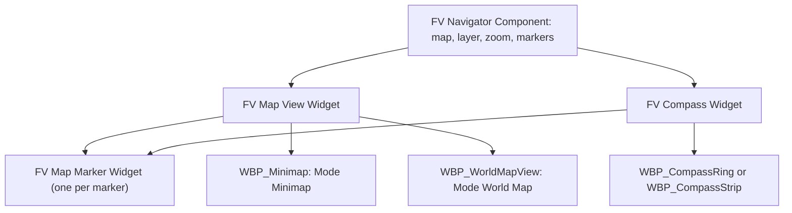
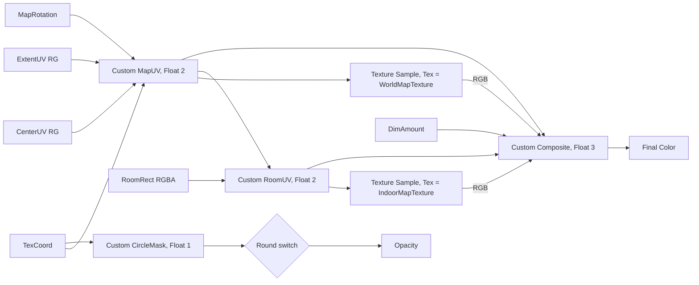

# FVNavigationSystem setup

Maps and floors, map markers, discovery of places, the tracked marker and the player's waypoint, and the minimap, compass and world map widgets. An editor tool captures map images from a top-down camera. The C++ widget classes do the work; your Widget Blueprints derive from them and add layout and looks.

Modules: `FVNavigationSystem`, `FVNavigationSystemDebug`, `FVNavigationSystemEditor` (Map Capture panel).

## 1. Quick start

1. Make a map definition with one layer (section 2) and add it to *FlickerVoid > Navigation > Maps*.
2. Make a capture camera Blueprint, place it over the area and capture the layer image (section 4).
3. Add **FV Navigator Component** to the player pawn or player controller (on a controller it follows the possessed pawn).
4. Make a marker definition with Minimap, Compass and World Map fragments, and add **FV Map Marker Component** to an actor with that definition.
5. Turn on `FVCvar.Navigation.Debug.HUD 1` and play; then build your HUD widgets on the views (section 6).

## 2. Map definitions

| Asset | Class | Key fields |
|---|---|---|
| `DA_Map_<Area>` | `FVMapDefinition` | **Priority** (higher wins where maps overlap: interior > district > world), **Available When** (e.g. the player bought the map), **Layers** |

Each **layer** is one image and the world area it covers: **Name** (e.g. `Ground`, `Floor1`), **Display Name** and **Texture**. The area (world XY rectangle), height range and whether the height counts are hidden in the editor: the capture tool writes them from its capture box (see Map capture below). The image top is north (+X) and its right edge east (+Y).

How the active map is chosen: the navigator asks for the highest-priority available map with a layer containing the player; a height-limited layer wins over an unlimited one. So walking into a building swaps to its interior map, and taking the stairs swaps the floor.

Typical set: `DA_Map_World` (priority 0, one large layer), `DA_Map_OldTown` (priority 10), `DA_Map_PoliceStation` (priority 20, layers `Basement`, `Ground`, `Floor1` with height limits).

## 3. Marker definitions

| Asset | Class | Key fields |
|---|---|---|
| `DA_Marker_<Kind>` | `FVMarkerDefinition` | Icon, name and tint from **Display**, category from **Tags** (e.g. `Marker.Category.Service`), **Priority** (draw order), **Visible When** (re-checked on every fact change), **Fragments** |

A marker shows only in the views whose fragment it has:

| Fragment | Fields |
|---|---|
| Minimap | **Clamp To Edge** (stay on the rim when out of range), **Max Distance** (0 = any), **Rotate With Actor** (vehicles) |
| World Map | **Min Zoom** (appears only when zoomed in that far), **Rotate With Actor** |
| Compass | **Max Distance** (0 = any) |
| Discovery | **Radius**, **Hidden Until Discovered** (otherwise shows with **Undiscovered Icon**), **On Discovered** effects |

Typical set: Shop, Inn, Quest Giver, Quest Target (minimap clamp, compass, world map; Visible When = quest active), Point of Interest (discovery), Fast Travel, and **Waypoint** (minimap clamp, compass, world map; set it in *FlickerVoid > Navigation > Waypoint Marker*).

## Gameplay tags

Defined natively; add children for your own:

| Root | Defaults | Use |
|---|---|---|
| `Marker.Category` | `Player`, `Quest`, `Exploration`, `Service`, `Travel` | Marker definition **Tags**; legend filters hide categories via the navigator's **Hidden Categories** |
| `Map` | `Map.World`, `Map.Region`, `Map.Interior` | Optional map **Id**, e.g. `Map.Interior.PoliceStation` |
| `Marker.Type` | `Waypoint`, `QuestTarget`, `QuestGiver`, `PointOfInterest`, `Shop`, `FastTravel` | Optional marker **Id** |

Map and marker definitions don't need an Id; set one when you want to find the definition by tag (debug commands) or refer to it from a fact. A display name is recommended (validation warns without one) and the icon is optional; a map's name and icon are what a world map shows in its map list or floor switcher.

## 4. Capturing map images

1. **Camera Blueprint**: make `BP_MapCapture` with parent class `FVMapCaptureActor`. It has a **Capture Box** (area and height) and a top-down orthographic **Capture Component**. Set post-process and show flags on the capture component to style the map, e.g. fixed exposure and no fog. Make several Blueprints for different looks if you like.
2. **Place and size**: drop it in the level and scale the box over the area. The camera sits at the top of the box looking down. For one floor of a building, fit the box between that floor and the ceiling.
3. **Fill in Map Capture**:

| Field | Meaning |
|---|---|
| Map | Map definition to write into |
| Layer | Layer name (dropdown of the map's layers); a missing layer is added |
| Resolution | Pixels along the longer side of the box |
| Texture Name | Asset name; empty uses `T_<Map>_<Layer>` |
| Limit Height | The layer only covers the box's height range and wins over layers without it while the player is inside. On for interiors and floors (a bar, `Floor1`), off for the outdoor ground layer |
| Clip Below Box | Stop rendering at the bottom of the box (unverified for orthographic captures; off by default) |
| Filter | Actors left out: **Ignored Classes**, **Ignored Actor Tags**, **Ignored Actors**, **Ignore Actors Above Box** (roofs over an interior), **Use Project Defaults** |

4. **Capture**: open *FlickerVoid menu > Navigation System > Map Capture* (or the level editor's *Window* menu). The panel lists every capture actor in the level with **Focus**, **Capture**, **Capture All** and the selected actor's details. The actor's Details panel also has a **Capture Map** button.

A capture saves the texture to the capture folder (or updates the layer's existing texture), then writes the texture, the exact captured area, the box's height range and **Limit Height** into the map layer. To change where a layer applies, resize its capture box and capture again. It can be undone, and a notification links to the texture. Characters are left out by default (`APawn` and the `MapCaptureIgnore` actor tag in project settings); tag anything else you don't want on the map with `MapCaptureIgnore`.

Capture actors are editor only and are stripped from cooked builds.

## 5. Components

| Component | Goes on | Notes |
|---|---|---|
| FV Navigator Component | Player pawn or player controller | Tracks the map underfoot (**On Active Map Changed**), discovers nearby places, builds the views. **Minimap** settings (radius, min/max radius, rotate with view, room radius scale), **Compass** (field of view), **Hidden Categories** (legend filters) |
| FV Map Marker Component | Anything shown on the map | **Definition**, **Label** (this place's own name), **Discovered Fact** (needed for Discovery markers so discoveries save), **Marker Enabled**. Scene component: place it where the icon should point. Event **On Discovered** |

Markers without an actor (quest areas, search zones): `UFVNavigationSubsystem` > `Add Marker At Location(Definition, Location, Label)` and `Remove Marker`.

## 6. Building the navigation UI

The plugin has C++ widget classes that do the work: they follow the navigator, load map textures, drive the map material and place marker icons. Your Widget Blueprints derive from them and add only layout, materials and looks, so their graphs stay empty unless you want extra cosmetics. Read [FVFramework > UI layout](FVFramework.md#3-ui-layout-and-hud-fvcoreui) first for where widgets go.



| C++ class | What it does |
|---|---|
| `UFVMapViewWidget` | Draws a map through a material on `MapImage`, a room layer over its dimmed base layer, and places marker icons. **Minimap** mode follows the player; **World Map** mode pans and zooms. |
| `UFVCompassWidget` | Turns a ring around the minimap or scrolls a strip, and places compass markers. |
| `UFVMapMarkerWidget` | One marker icon: sets its icon and tint, and calls **On Marker Changed** for the rest of its looks. |

The classes find their widgets by name (`BindWidget`): a required widget missing from the designer is a compile error in the Widget Blueprint, an optional one just turns that feature off.

### 6.1 Where the widgets live

| Widget | Parent class | Where |
|---|---|---|
| `WBP_GameHUD` | Common Activatable Widget | `UI.Layer.HUD`, pushed once when the layout is ready |
| `WBP_Minimap` | FV Map View Widget (Mode *Minimap*) | Inside `WBP_GameHUD` |
| `WBP_CompassRing` / `WBP_CompassStrip` | FV Compass Widget | The ring inside `WBP_Minimap`, the strip inside `WBP_GameHUD` |
| `WBP_WorldMap` | Common Activatable Widget | `UI.Layer.GameMenu`, pushed by an *Open Map* action and popped by *Back* |
| `WBP_WorldMapView` | FV Map View Widget (Mode *World Map*) | Inside `WBP_WorldMap` |
| `WBP_MapMarker` | FV Map Marker Widget | Created by the map views and compasses, one per marker, reused |

You do **not** need a Navigation layer: the minimap and compass are always-on HUD elements inside the one HUD widget, and the world map is a full-screen menu on the menu layer.

The widgets find the navigator themselves: on the owning player's controller, else on their pawn.

### 6.2 Map material

One material serves the minimap and the world map: `M_MapView`, Material Domain *User Interface*, Blend Mode *Translucent* (soft round edge) or *Masked*. Make two instances: `MI_Minimap` (Round on) and `MI_WorldMap` (Round off).

The map view sets these parameters by name:

| Parameter | Type | Default | Set to |
|---|---|---|---|
| `WorldMapTexture` | Texture Object | any capture | The base layer's image |
| `IndoorMapTexture` | Texture Object | any capture | The room layer's image |
| `CenterUV`, `ExtentUV` | Vector (R, G used) | (0.5, 0.5), (0.1, 0.1) | View centre and half-size in base layer UV |
| `MapRotation` | Scalar | 0 | Degrees clockwise the image turns |
| `RoomRect` | Vector (RGBA used) | (-2, -2, -1, -1) | Room area in base layer UV (min U, min V, max U, max V); the default means no room |
| `DimAmount` | Scalar | 0 | Base layer dimming: 0 none, 1 black |
| `Round` | Static Switch | true | Circular mask (off for the world map) |



Custom nodes (set each one's **Output Type**; a Float 2 Composite drops the blue channel and the map turns yellow):

- **MapUV** (inputs `UV`, `CenterUV`, `ExtentUV`, `RotationDeg`; Float 2):
  ```hlsl
  float2 p = (UV - 0.5) * 2;                       // -1..1, +Y down
  float a = radians(RotationDeg);
  float2 q = float2(p.x * cos(a) + p.y * sin(a),
                    -p.x * sin(a) + p.y * cos(a));
  return CenterUV + q * ExtentUV;
  ```
  A positive `MapRotation` turns the image clockwise. The minimap sets it to minus the camera yaw, so the view direction points up.
- **RoomUV** (inputs `WorldUV`, `RoomRect`; Float 2):
  ```hlsl
  return (WorldUV - RoomRect.xy) / max(RoomRect.zw - RoomRect.xy, 1e-5);
  ```
- **Composite** (inputs `WorldColor`, `WorldUV`, `RoomColor`, `RoomUV`, `DimAmount`; Float 3):
  ```hlsl
  float worldIn = (all(WorldUV >= 0) && all(WorldUV <= 1)) ? 1 : 0;
  float roomIn  = (all(RoomUV  >= 0) && all(RoomUV  <= 1)) ? 1 : 0;
  float3 world = WorldColor * worldIn * (1 - DimAmount);
  return lerp(world, RoomColor, roomIn);
  ```
- **CircleMask** (input `UV`; Float 1):
  ```hlsl
  float d = length((UV - 0.5) * 2);
  return 1 - smoothstep(0.97, 1.0, d);
  ```

Set **Sampler Source** to *Shared: Clamp* on both Texture Sample nodes, otherwise the image repeats outside its area. Wire the Round switch's False input to 1.

### 6.3 Marker icon

**`WBP_MapMarker`**, parent **FV Map Marker Widget**:
- An `Image` named **Icon** (optional). It gets the marker definition's icon and tint, or the Discovery fragment's **Undiscovered Icon** while undiscovered.
- Optional extras driven from **On Marker Changed**(Marker), which runs on every view update: Above / Below arrows from `Marker.Elevation`, a distance text from **Format Distance**(`Marker.Distance`), a highlight when `Marker.Tracked`, dimming when `Marker.Clamped`.
- The icon is centred on its spot and keeps its desired size, so give the root a fixed size (e.g. a 24 x 24 SizeBox).

Set it as **Marker Widget Class** on the map views and compasses.

### 6.4 Minimap

**`WBP_Minimap`**, parent **FV Map View Widget**, designer:
```
Overlay                         the widget's size is the minimap's, e.g. 256 x 256 from the HUD slot
 ├ Image "MapImage"             Fill; brush = MI_Minimap
 ├ CanvasPanel "MarkerCanvas"   Fill
 ├ WBP_CompassRing              Fill (optional, 6.5)
 └ Image "PlayerIcon"           Centre; arrow pointing up
```
Class Defaults: **Mode** *Minimap*, **Marker Widget Class** `WBP_MapMarker`, **Room Dim** (how dark the street gets while a room shows), **Transition Speed** (zoom and dim easing), **Edge Padding** (pixels between the rim and pinned markers), **Rotate Player Icon** (off: the arrow always points up).

What it does on its own:
- Follows the player on the active map and turns with the camera (navigator **Minimap > Rotate With View**; off keeps north up).
- Outdoors it shows the base layer. Inside a room (a height-limited layer) it draws the room over the base layer once the room image has loaded, dims the base layer by **Room Dim** and zooms to fit the room (navigator **Minimap > Room Radius Scale**, the room's half-size times this; 0 turns it off). Leaving the room reverses both.
- Places markers from the navigator's minimap view; out-of-range markers that clamp to the edge sit on the rim.
- Hides `MapImage` while the player is outside every map, and shows the right map from the start, so nothing waits for **On Active Map Changed**.

**Zoom** from input: `Zoom At(any position, 1.25)` zooms in and `0.8` out. On the minimap this changes the navigator's **Minimap > Radius**, clamped to **Min/Max Radius**.

### 6.5 Compass

**Ring** (around the minimap): **`WBP_CompassRing`**, parent **FV Compass Widget**, **Style** *Ring*:
```
Overlay
 ├ Image "Ring"                 Fill; ring art with N at the top
 └ CanvasPanel "MarkerCanvas"   Fill (optional)
```
The ring turns with the minimap, or stays north-up when the minimap does. Markers sit around it at **Marker Radius** (0 is the edge). For markers all the way round, set the navigator's **Compass > Field Of View** to 360.

**Strip**: **`WBP_CompassStrip`**, **Style** *Strip*:
```
SizeBox (e.g. 600 x 48)
 └ Overlay
    ├ Image "Strip"               brush = a material sampling a 360-degree texture at U * CompassTiling + CompassOffset
    ├ CanvasPanel "MarkerCanvas"  Fill
    └ Image "CentreLine"          centred notch (cosmetic)
```
The strip texture holds the ticks and letters with north at U = 0, tiling horizontally; the widget sets the scalar parameters `CompassTiling` and `CompassOffset` from the heading. Set the navigator's **Compass > Field Of View** to the degrees the strip shows (e.g. 180). Tracked markers outside it clamp to the ends.

### 6.6 World map

**`WBP_WorldMapView`**, parent **FV Map View Widget**, **Mode** *World Map*, same hierarchy as the minimap without the compass, with `MapImage` using `MI_WorldMap` and a player arrow as **PlayerIcon**. Class Defaults: **Max Zoom**, **Zoom Step** (per wheel notch), **Room Dim**, **Marker Widget Class**.

**`WBP_WorldMap`** (Common Activatable Widget; input mode *Menu*, shows the cursor) holds `WBP_WorldMapView` filling the screen, plus a floor list, a legend and buttons.

What the map view does on its own:
- Opens on the player's map and layer, centred on the player; with no active map it shows the first map in the settings.
- Drag with the left mouse button to pan, wheel to zoom around the cursor (1 = whole layer fits, up to **Max Zoom**). The view stays inside the image.
- A room floor shows over its dimmed base layer, centred and zoomed to fit.
- Moves **PlayerIcon** to the player and turns it, hiding it while the player is on another layer.
- Places markers from the navigator's world map view; markers with a World Map fragment **Min Zoom** appear once the zoom reaches it.

Events and nodes for the Blueprint:
- **On Map Clicked**(Local Position, World Location): a click that wasn't a drag. Typical use:
  ```
  if Find Marker At(Local Position, 20) -> Marker:
      if Equal (Marker Handle)(Marker.Handle, Navigation.GetWaypoint()): Navigation.ClearWaypoint()
      else: Navigation.SetTrackedMarker(Marker.Handle)
  else: Navigation.SetWaypoint(World Location)
  ```
  (`Navigation` = the FV Navigation Subsystem.)
- **On Shown Map Changed**(Map, Layer Index): rebuild the floor list from `Map.Layers` (`DisplayName`); a floor button calls **Show Map**(Map, its index).
- **Center On Player**, **Pan**(Delta Pixels) and **Zoom At**(Local Position, Factor) for buttons and gamepad sticks; **Local To World** for anything else that needs the world location under a point.
- **Legend**: category toggles (`Marker.Category.*`) call `Navigator.SetCategoryHidden(Category, bHidden)`; the minimap, compass and world map all respect it, except the tracked marker.

### 6.7 Waypoint, tracking and discovery events

On `UFVNavigationSubsystem` (`UFVNavigationSubsystem::Get()` in AngelScript, *Get World Subsystem* in Blueprint):
- `SetWaypoint(Location)` replaces the previous waypoint and tracks it; `ClearWaypoint`; `SetTrackedMarker(Handle)` for the active quest target.
- The tracked marker ignores distance and category filters and stays pinned to the minimap and compass edges.
- Events: **On Marker Added / Removed / Discovered / Visibility Changed**, **On Tracked Marker Changed**, **On Waypoint Changed**. Use **On Marker Discovered** for a "New location discovered" toast (the label is on the marker's component: `GetMarkerActor` then its FV Map Marker Component `GetLabel`, or the definition's `Display.Name`).
- Entering a Discovery fragment's radius sets the marker component's **Discovered Fact**, applies **On Discovered** effects and fires **On Marker Discovered**.

### 6.8 Blueprint helpers

**FV Navigation Library**: **Format Distance**(cm) gives "85 m" or "1.2 km"; **Is Valid Marker** and **Equal (Marker Handle)** compare marker handles.

For a widget the classes above don't cover, the navigator still builds the raw views: **Build Minimap View**(Radius), **Build Compass View** and **Build World Map View**(Map, Layer Index, Zoom), plus **Get Minimap Radius** for the zoom it wants. **Find For Player** gets the navigator from a player controller.

## 7. Settings

*FlickerVoid > Navigation* (also *FlickerVoid menu > Navigation System > Global Settings*):

| Setting | Meaning |
|---|---|
| Maps | Every map the player can be on |
| Waypoint Marker | Marker definition for the player's waypoint |
| Elevation Threshold | Height difference that counts as above or below |
| Update Interval | Seconds between the navigator's map and discovery checks |
| Capture Folder | Where new map textures are saved |
| Capture Ignored Classes / Actor Tags | Left out of every capture (defaults: `APawn`, `MapCaptureIgnore`) |

## 8. Debug

| CVar / command | Effect |
|---|---|
| `FVCvar.Navigation.Debug.HUD 1` | Active map and layer, map UV, heading, nearby markers |
| `FVCvar.Navigation.Debug.Range <cm>` | How far the HUD lists markers |
| `FV.Navigation.ListMarkers` | Log every marker with its id |
| `FV.Navigation.DiscoverAll` | Discover everything |
| `FV.Navigation.Waypoint <X> <Y>` | Set the waypoint; no arguments clears it |
| `FV.Navigation.Track <MarkerId>` | Track a marker; no argument stops tracking |

## Not yet done

The waypoint and the tracked marker are not saved; there is no fog of war over unexplored areas.
